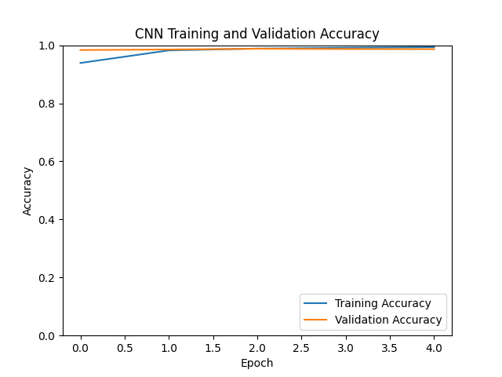

# Lab 09: Building a Basic CNN for Digit Recognition

## 1. Project Overview

This project demonstrates how to build and train a Convolutional Neural Network (CNN) to recognize handwritten digits using the MNIST dataset.

The model classifies images into 10 categories: digits 0 to 9.

## 2. Objectives

- Understand the basics of CNN.
- Load and preprocess the MNIST dataset.
- Build a CNN using TensorFlow and Keras.
- Train the model using handwritten digit images.
- Evaluate model performance on test data.
- Save the trained model and accuracy graph.

## 3. Technologies Used

- Python 3.12.3
- TensorFlow CPU 2.17.0
- Keras 3.15.1
- NumPy 1.26.4
- Matplotlib 3.9.2
- Ubuntu 24.04 LTS

## 4. Dataset

The project uses the MNIST handwritten digit dataset.

- Training images: 60,000
- Testing images: 10,000
- Image size: 28 × 28 pixels
- Image type: Grayscale
- Classes: 10 (digits 0–9)

## 5. Data Preprocessing

The following preprocessing steps were performed:

1. Loaded the MNIST dataset.
2. Reshaped images to include a channel dimension.
3. Converted pixel values to the range 0 to 1.
4. Converted labels into one-hot encoded format.
5. Used 10% of the training data for validation.

## 6. CNN Architecture

| Layer | Configuration |
|---|---|
| Input | 28 × 28 × 1 |
| Conv2D | 32 filters, 3 × 3, ReLU |
| MaxPooling2D | 2 × 2 |
| Conv2D | 64 filters, 3 × 3, ReLU |
| MaxPooling2D | 2 × 2 |
| Conv2D | 64 filters, 3 × 3, ReLU |
| Flatten | Converts features into a vector |
| Dense | 64 neurons, ReLU |
| Output | 10 neurons, Softmax |

**Total trainable parameters:** 93,322

## 7. Model Compilation

The model was compiled using:

- Optimizer: Adam
- Loss function: Categorical Crossentropy
- Evaluation metric: Accuracy

## 8. Model Training

Training configuration:

- Epochs: 5
- Batch size: 64
- Validation split: 10%
- Framework: TensorFlow/Keras

## 9. Training Results

| Metric | Result |
|---|---:|
| Training Accuracy | 99.34% |
| Validation Accuracy | 98.65% |
| Test Accuracy | 98.77% |
| Test Loss | 0.0427 |

The model achieved **98.77% accuracy** on the unseen test dataset.

## 10. Training Accuracy Graph

The following graph shows training and validation accuracy across five epochs.



## 11. Generated Files

- `cnn.py` - CNN implementation and training script.
- `mnist_cnn.keras` - Saved trained model.
- `history.png` - Training and validation accuracy graph.
- `evidence/history.png` - Graph stored in the evidence folder.
- `train.log` - Partial TensorFlow startup log.
- `requirements.txt` - Python dependencies.

## 12. How to Run the Project

Create and activate a virtual environment:

```bash
python3 -m venv venv
source venv/bin/activate
```

Install dependencies:

```bash
pip install -r requirements.txt
```

Run the CNN training script:

```bash
python -u cnn.py
```

To save the terminal output:

```bash
python -u cnn.py 2>&1 | tee train.log
```

## 13. Key Learning Outcomes

- Understood how CNNs process image data.
- Learned image normalization and reshaping.
- Implemented convolution and pooling layers.
- Trained a neural network using MNIST.
- Evaluated model accuracy and loss.
- Saved a trained model in Keras format.

## 14. Conclusion

A basic Convolutional Neural Network was successfully developed and trained to recognize handwritten digits using the MNIST dataset.

The model achieved **98.77% test accuracy**, demonstrating effective image classification using TensorFlow and Keras.
