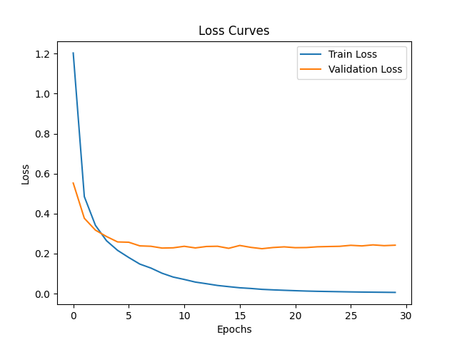
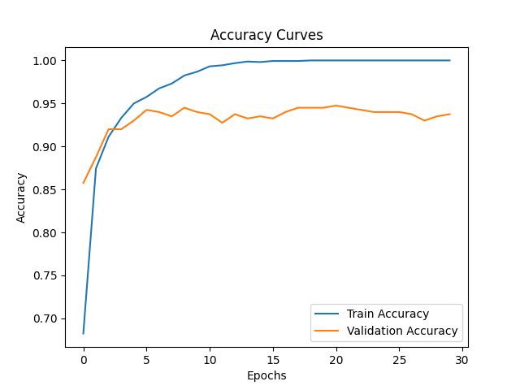

# Lab 10: Visualizing Training History

## 1. Project Overview

This project demonstrates how to capture, save, and visualize the training history of a neural network using TensorFlow/Keras and Matplotlib.

The model is trained using the MNIST handwritten digit dataset. Training and validation metrics are saved in JSON format and displayed through loss and accuracy graphs.

## 2. Objectives

- Train a basic neural network using the MNIST dataset.
- Record training and validation metrics.
- Save training history in JSON format.
- Visualize training and validation loss.
- Visualize training and validation accuracy.
- Understand model convergence and overfitting.

## 3. Technologies Used

- Python 3.12
- TensorFlow CPU 2.17.0
- Keras
- Matplotlib 3.9.2
- NumPy 1.26.4
- Ubuntu Linux

## 4. Dataset

The MNIST dataset contains grayscale images of handwritten digits from 0 to 9.

For this experiment:

- 2,000 training images were selected.
- Each image was flattened into 784 features (28 × 28).
- Pixel values were normalized between 0 and 1.
- 80% of the selected data was used for training.
- 20% was used for validation.

## 5. Model Architecture

The neural network contains:

| Layer | Configuration |
|---|---|
| Input Layer | 784 features |
| Hidden Layer | 128 neurons, ReLU activation |
| Output Layer | 10 neurons, Softmax activation |

### Model Compilation

- Optimizer: Adam
- Loss Function: Sparse Categorical Crossentropy
- Evaluation Metric: Accuracy
- Training Epochs: 30
- Validation Split: 20%

## 6. Training History

Keras provides a History object after model training.

The `history.history` dictionary stores:

- `loss`: Training loss
- `val_loss`: Validation loss
- `accuracy`: Training accuracy
- `val_accuracy`: Validation accuracy

These metrics are saved in `history.json` for later analysis.

## 7. Training Results

The model completed all 30 epochs successfully.

| Metric | First Epoch | Final Epoch |
|---|---:|---:|
| Training Loss | 1.2031 | 0.0062 |
| Validation Loss | 0.5530 | 0.2423 |
| Training Accuracy | 68.25% | 100% |
| Validation Accuracy | 85.75% | 93.75% |

### Best Validation Loss

- Lowest validation loss: 0.2247
- Best epoch: 18
- Total epochs: 30

## 8. Training and Validation Loss Graph



**Observation:**

Training loss decreased throughout the training process. Validation loss reached its lowest value at epoch 18 and then generally increased.

## 9. Training and Validation Accuracy Graph



**Observation:**

Training accuracy reached 100%, while final validation accuracy reached 93.75%.

## 10. Analysis and Observations

1. The model learned the training data effectively.
2. Training loss decreased from 1.2031 to 0.0062.
3. Training accuracy increased to 100%.
4. Validation accuracy reached 93.75%.
5. Validation loss was lowest at epoch 18.
6. After epoch 18, validation loss generally increased while training loss continued decreasing.

### Overfitting Observation

The difference between training and validation performance, along with the rising validation loss after its best point, indicates signs of overfitting.

The model learned the training examples extremely well but did not improve consistently on validation data.

### Possible Improvements

- Early stopping
- Dropout regularization
- More training data
- Hyperparameter tuning

## 11. Project Structure

```text
Lab-10-Visualizing-Training-History/
├── train.py
├── plot.py
├── history.json
├── train.log
├── loss.png
├── accuracy.png
├── requirements.txt
├── .gitignore
├── README.md
└── evidence/
    ├── loss.png
    └── accuracy.png
```

## 12. How to Run

### Step 1: Clone the repository

```bash
git clone https://github.com/abeerashah2009/DEEP-LEARNING-ALRAZZAQ-PART-1.git
cd DEEP-LEARNING-ALRAZZAQ-PART-1/Lab-10-Visualizing-Training-History
```

### Step 2: Create and activate a virtual environment

```bash
python3 -m venv venv
source venv/bin/activate
```

### Step 3: Install dependencies

```bash
pip install -r requirements.txt
```

### Step 4: Train the model

```bash
python train.py
```

The training history will be saved in `history.json`.

### Step 5: Generate graphs

```bash
python plot.py
```

The scripts generate `loss.png` and `accuracy.png`.

## 13. Learning Outcomes

Through this project, I learned how to:

- Capture training history using Keras.
- Store training metrics in JSON format.
- Create graphs using Matplotlib.
- Interpret training and validation curves.
- Identify signs of overfitting.
- Organize machine learning experiment results for a GitHub portfolio.

## 14. Conclusion

This experiment demonstrates how training history can be used to understand neural network performance.

Visualizing training and validation metrics makes it easier to evaluate learning progress, identify possible overfitting, and decide where model improvements are needed.
