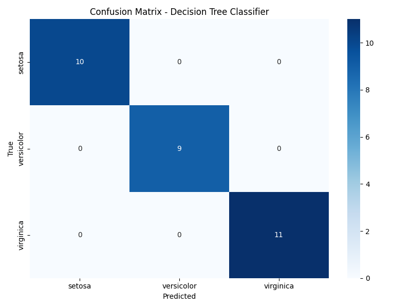

# Lab 11: Model Evaluation Using a Confusion Matrix

## Overview

This project demonstrates how to evaluate a Machine Learning classification model using a confusion matrix and classification metrics.

The Iris dataset is used to train and test a Decision Tree Classifier.

## Objectives

- Load the Iris dataset.
- Split data into training and testing sets.
- Train a Decision Tree Classifier.
- Generate predictions.
- Create and visualize a confusion matrix.
- Calculate precision, recall, F1-score, and accuracy.
- Compare manually calculated accuracy with Scikit-learn accuracy.

## Technologies Used

- Python 3
- NumPy
- Pandas
- Matplotlib
- Seaborn
- Scikit-learn

## Dataset

The Iris dataset contains three flower classes:

- Setosa
- Versicolor
- Virginica

The dataset was divided as follows:

| Dataset | Samples |
|---|---:|
| Training | 120 |
| Testing | 30 |
| Total | 150 |

The split uses `test_size=0.2` and `random_state=42`.

## Model

A Decision Tree Classifier was trained using:

`DecisionTreeClassifier(random_state=42)`

The trained model generated predictions for the 30 test samples.

## Confusion Matrix

The resulting confusion matrix:

```text
[[10  0  0]
 [ 0  9  0]
 [ 0  0 11]]
```

Rows represent actual classes, while columns represent predicted classes.

All values are on the diagonal, meaning all 30 test samples were classified correctly in this experiment.

## Model Evaluation Results

| Metric | Setosa | Versicolor | Virginica |
|---|---:|---:|---:|
| Precision | 1.00 | 1.00 | 1.00 |
| Recall | 1.00 | 1.00 | 1.00 |
| F1-score | 1.00 | 1.00 | 1.00 |

Overall accuracy: **100%**

Incorrect predictions: **0**

Manual accuracy and Scikit-learn accuracy were also compared and matched.

## Confusion Matrix Visualization

The generated heatmap is available here:



## Project Structure

```text
Lab-11-Model-Evaluation-Confusion-Matrix/
├── cm_lab.py
├── cm.png
├── results.txt
├── requirements.txt
├── README.md
├── .gitignore
└── evidence/
    ├── cm.png
    └── results.txt
```

## How to Run

1. Clone the repository.
2. Open the lab directory.
3. Create and activate a virtual environment.
4. Install dependencies:

```bash
pip install -r requirements.txt
```

5. Run the Python script:

```bash
python3 cm_lab.py
```

The script displays evaluation metrics and generates `cm.png`.

## Learning Outcomes

- Understood how to evaluate a classification model.
- Learned how to create and interpret a confusion matrix.
- Practiced calculating precision, recall, and F1-score.
- Compared manual metric calculations with Scikit-learn.
- Learned to visualize model evaluation results.

## Conclusion

The Decision Tree Classifier correctly classified all 30 test samples in this particular Iris dataset split.

The experiment provided practical experience with model evaluation, classification metrics, and confusion matrix visualization.

A perfect result on this small test set does not guarantee the same performance on unseen datasets.
