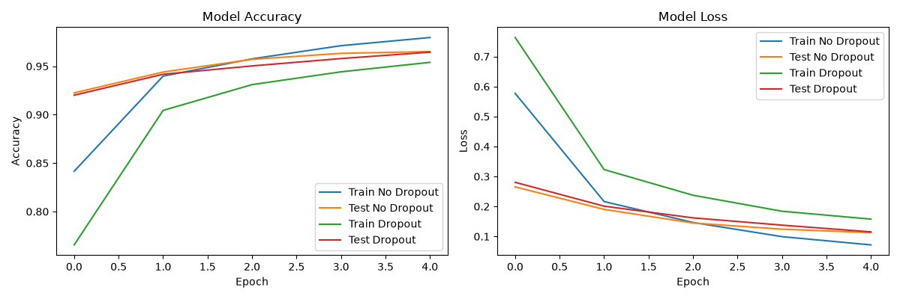

# Lab 12: Implementing Dropout Regularization

## Overview

This project demonstrates Dropout Regularization in a
Convolutional Neural Network (CNN).

Two CNN models are trained using the MNIST handwritten
digit dataset:

1. CNN without Dropout.
2. CNN with Dropout.

Their training and validation performance is compared
to understand the effect of Dropout on overfitting.

## Objectives

- Understand Dropout Regularization.
- Build a CNN using Keras and TensorFlow.
- Add Dropout layers to a CNN.
- Train models with and without Dropout.
- Compare training and validation accuracy.
- Visualize model accuracy and loss.
- Analyze the training/validation gap.

## Technologies Used

- Python 3
- TensorFlow 2.17.0
- Keras 3
- NumPy
- Matplotlib

## Dataset

The MNIST dataset contains handwritten digit images
from 0 to 9.

Each image has a size of 28 x 28 pixels.

Dataset used in this experiment:

| Dataset | Images |
|---|---:|
| Training | 10,000 |
| Testing | 10,000 |
| Total used | 20,000 |

Training images were normalized to values between
0 and 1.

Labels were converted using one-hot encoding.

## CNN Architecture

The CNN contains:

- Input layer
- Convolutional layer with 32 filters
- Max pooling layer
- Flatten layer
- Dense layer with 128 neurons
- Output layer with 10 classes

The Dropout model additionally uses:

- Dropout rate 0.25 after max pooling
- Dropout rate 0.50 after the dense layer

Dropout is active during training and inactive
during evaluation.

## Training Configuration

| Setting | Value |
|---|---|
| Optimizer | Adam |
| Loss function | Categorical Crossentropy |
| Epochs | 5 |
| Batch size | 128 |
| Training images | 10,000 |
| Validation images | 10,000 |

The same random seed is used when creating both
models to make their initial trainable weights
comparable.

## Model Comparison

Both models are trained and evaluated using the
same training and validation datasets.

The training/validation gap is calculated as:

`Training Accuracy - Validation Accuracy`

A smaller positive gap can indicate less
overfitting, but it should also be considered
alongside validation accuracy.

## Actual Experimental Results

The measured results from this run are saved in:

- `observations.txt`
- `train.log`

These files contain the actual metrics. Results
may vary with hardware and software environments.

## Accuracy and Loss Visualization



The graph compares training and validation
accuracy and loss for both models.

## Project Structure

```text
Lab-12-Implementing-Dropout-Regularization/
├── dropout_lab.py
├── dropout_comparison.png
├── train.log
├── observations.txt
├── requirements.txt
├── README.md
├── .gitignore
└── evidence/
    ├── dropout_comparison.png
    ├── train.log
    └── observations.txt
```

## How to Run

Create and activate a virtual environment:

```bash
python3 -m venv ~/lab-venv
source ~/lab-venv/bin/activate
```

Install dependencies:

```bash
pip install -r requirements.txt
```

Run the lab:

```bash
python dropout_lab.py
```

The script generates the comparison graph and
prints the final model metrics.

## Learning Outcomes

- Learned the purpose of Dropout Regularization.
- Implemented Dropout in a CNN.
- Compared models with and without Dropout.
- Practiced TensorFlow and Keras model training.
- Analyzed accuracy, loss and generalization gaps.

## Conclusion

Dropout randomly disables a fraction of neurons
during training to help reduce overfitting.

This experiment compares two CNN models using
the MNIST dataset. The actual results show how
Dropout affects training accuracy, validation
accuracy and the training/validation gap.

A smaller gap alone does not prove better model
performance; validation accuracy must also be
considered.
