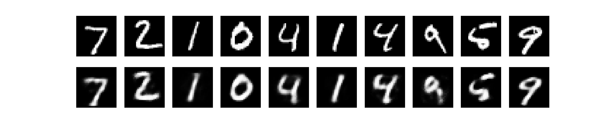

# Lab 14: Constructing and Training an Autoencoder

## Overview

This lab demonstrates how to construct and train a basic autoencoder using TensorFlow and Keras.

The model learns to compress MNIST handwritten digit images into a smaller representation and reconstruct the original images.

## Objectives

- Understand the basic concept of an autoencoder.
- Load and preprocess the MNIST dataset.
- Build an encoder and decoder using Dense layers.
- Train the autoencoder using Adam optimizer.
- Compare original and reconstructed images.
- Calculate reconstruction Mean Squared Error (MSE).

## Technologies Used

- Ubuntu 24.04
- Python 3.12
- TensorFlow CPU 2.17.0
- Keras 3.15.1
- NumPy 1.26.4
- Matplotlib 3.9.2

## Model Architecture

The autoencoder uses three main layers:

| Layer | Output Dimension | Activation |
|---|---:|---|
| Input | 784 | — |
| Encoder | 32 | ReLU |
| Decoder | 784 | Sigmoid |

The encoder compresses each 784-dimensional image into 32 dimensions. The decoder reconstructs the image.

## Dataset

The MNIST dataset contains handwritten digit images.

- Training samples: 60,000
- Testing samples: 10,000
- Original image size: 28 × 28 pixels
- Flattened input size: 784
- Pixel values normalized between 0 and 1

## Training Configuration

- Optimizer: Adam
- Loss function: Binary Crossentropy
- Epochs: 5
- Batch size: 256
- Shuffle: True
- Validation data: MNIST test dataset

## Training Results

| Epoch | Training Loss | Validation Loss |
|---|---:|---:|
| 1 | 0.2775 | 0.1895 |
| 2 | 0.1693 | 0.1524 |
| 3 | 0.1440 | 0.1340 |
| 4 | 0.1292 | 0.1221 |
| 5 | 0.1190 | 0.1138 |

Final training loss: **0.11905**

Final validation loss: **0.11379**

Test reconstruction MSE: **0.01630**

## Reconstruction Results

The model reconstructs handwritten digits after compressing their representations.

The generated image compares:

- Top row: Original MNIST images.
- Bottom row: Reconstructed images.

### Reconstruction Output



## Project Files

| File | Description |
|---|---|
| `autoencoder.py` | Autoencoder implementation and training script |
| `reconstruction.png` | Original and reconstructed image comparison |
| `README.md` | Lab documentation |
| `venv/` | Python virtual environment (not committed to Git) |

## How to Run

Create and activate a virtual environment:

```bash
python3 -m venv venv
source venv/bin/activate
```

Install the required packages:

```bash
pip install tensorflow-cpu==2.17.0 matplotlib==3.9.2 numpy==1.26.4
```

Run the program:

```bash
python autoencoder.py
```

The program trains the model, calculates reconstruction MSE, and generates `reconstruction.png`.

## Conclusion

This lab demonstrates how an autoencoder compresses and reconstructs handwritten digit images.

The training and validation losses decreased over five epochs, showing that the model learned to reconstruct the MNIST images.

Autoencoders can also be applied to dimensionality reduction, image denoising, and feature learning.

## Learning Outcome

Successfully implemented and trained a basic autoencoder using TensorFlow and Keras, and evaluated its reconstruction performance using Mean Squared Error.
