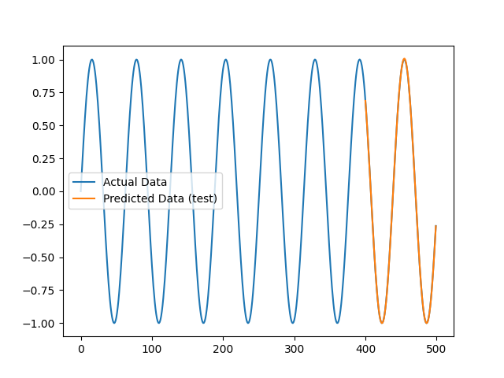

# Lab 16: LSTM Networks for Sequence Modeling

---

## 1. Introduction

**LSTM (Long Short-Term Memory)** is a type of Recurrent Neural Network (RNN) designed to learn patterns from sequential data.

LSTM networks can remember important information from previous time steps and use it to make predictions.

They are commonly used in:

- Time-series forecasting
- Speech recognition
- Natural language processing
- Stock price prediction
- Sequence prediction

## 2. Objectives

The main objectives of this lab are:

1. Understand the concept of LSTM networks.
2. Learn how LSTM processes sequential data.
3. Build an LSTM model using TensorFlow and Keras.
4. Prepare sequence-based training and testing data.
5. Train the model and evaluate its performance.
6. Generate predictions and visualize the results.

## 3. What Is Sequence Modeling?

Sequence modeling is a machine learning technique used to understand and predict data that follows a particular order.

**Example:**

- Daily temperature readings
- Monthly sales records
- Stock market prices
- Text and speech data

In this lab, we use a sine-wave dataset to understand how an LSTM model learns sequential patterns.

## 4. What Is LSTM?

LSTM stands for **Long Short-Term Memory**.

It is an advanced type of RNN that uses memory cells and gates to control information.

LSTM contains three main gates:

### A. Forget Gate

Decides which information should be removed from memory.

### B. Input Gate

Decides which new information should be stored in memory.

### C. Output Gate

Decides which information should be passed to the next step.

These gates help LSTM remember important information for longer periods.

## 5. Technologies Used

| Technology | Purpose |
|---|---|
| Python 3.12 | Programming language |
| TensorFlow 2.17.0 | Deep learning framework |
| Keras 3.15.1 | Model building |
| NumPy 1.26.4 | Numerical operations |
| Matplotlib 3.9.2 | Data visualization |
| Ubuntu 24.04 | Operating system |

## 6. Dataset Preparation

In this practical, we generate a sine-wave dataset using NumPy.

The dataset contains 500 data points.

The sequence is divided into smaller input samples.

Each input sample contains 3 time steps and is used to predict the next value.

### Dataset Configuration

- Total data points: 500
- Input sequence length: 3
- Training data: 80%
- Testing data: 20%

### Dataset Shapes

| Dataset | Shape |
|---|---|
| X_train | (397, 3, 1) |
| X_test | (100, 3, 1) |
| y_train | (397,) |
| y_test | (100,) |

## 7. LSTM Model Architecture

We use the Keras Sequential API to build our LSTM model.

### Model Layers

**1. Input Layer**

- Input shape: (3, 1)
- Represents 3 time steps and 1 feature.

**2. LSTM Layer**

- Contains 50 LSTM units.
- Learns patterns from sequential data.

**3. Dense Layer**

- Contains 1 neuron.
- Produces the final predicted value.

### Model Configuration

| Parameter | Value |
|---|---|
| Model Type | Sequential |
| LSTM Units | 50 |
| Output Neurons | 1 |
| Optimizer | Adam |
| Loss Function | Mean Squared Error |
| Epochs | 50 |
| Batch Size | 16 |
| Total Parameters | 10,451 |

## 8. Model Training

The model is trained using the prepared sine-wave dataset.

During training:

1. Input sequences are provided to the model.
2. The LSTM layer learns sequential patterns.
3. The Dense layer generates predictions.
4. The loss function measures prediction errors.
5. The Adam optimizer updates model weights.
6. This process continues for 50 epochs.

## 9. Model Evaluation

After training, the model is evaluated using the testing dataset.

We use **Mean Squared Error (MSE)** to measure prediction performance.

MSE calculates the average squared difference between actual and predicted values.

A lower MSE indicates better prediction accuracy.

### Final Results

| Evaluation Metric | Result |
|---|---:|
| Final Training Loss | 0.00001417 |
| Test MSE | 0.00001312 |
| Predictions Generated | 100 |
| Total Parameters | 10,451 |

**Observation:**

The test MSE is approximately 0.00001312, which is below 0.01. This indicates that the model achieved a low prediction error on the test dataset.

## 10. Actual vs Predicted Graph

The following visualization compares the actual sine-wave values with the predictions generated by the trained LSTM model.



**Graph Observation:**

- The actual values represent the original sequence.
- The predicted values represent the model's output.
- Comparing both helps us understand how accurately the model learned the sequence patterns.

## 11. Project Files

```text
Lab-16-LSTM-Networks-for-Sequence-Modeling/
│
├── lstm.py
├── lstm.png
├── requirements.txt
└── README.md
```

| File | Description |
|---|---|
| lstm.py | Python program for building and training the LSTM model |
| lstm.png | Actual vs predicted visualization |
| requirements.txt | Required Python packages |
| README.md | Lab documentation and notes |

## 12. Commands Used

### Create Virtual Environment

```bash
python3 -m venv venv
```

### Activate Virtual Environment

```bash
source venv/bin/activate
```

### Install Dependencies

```bash
pip install -r requirements.txt
```

### Run Python Program

```bash
python lstm.py
```

### Check Project Files

```bash
ls -lh
```

## 13. Important Interview Questions

**Q1. What does LSTM stand for?**

LSTM stands for Long Short-Term Memory. It is a type of Recurrent Neural Network that can learn long-term dependencies in sequential data.

**Q2. Why do we use LSTM?**

We use LSTM to process sequential data and remember important information from previous time steps.

**Q3. What are the three main gates of LSTM?**

- Forget Gate
- Input Gate
- Output Gate

**Q4. What is sequence modeling?**

Sequence modeling is a technique used to understand patterns in ordered data and predict future values.

**Q5. What is the purpose of the Dense layer?**

The Dense layer produces the final output or prediction from the learned features.

**Q6. What is Mean Squared Error (MSE)?**

MSE measures the average squared difference between actual values and predicted values.

**Q7. Which optimizer is used in this lab?**

The Adam optimizer is used to update the model weights during training.

**Q8. What is an epoch?**

An epoch represents one complete pass through the training dataset.

## 14. Learning Outcomes

After completing this lab, I learned how to:

- Understand LSTM networks and their architecture.
- Work with sequential and time-series data.
- Prepare input sequences for deep learning.
- Build an LSTM model using TensorFlow and Keras.
- Train and evaluate a neural network.
- Generate predictions from test data.
- Visualize actual and predicted values using Matplotlib.

## 15. Conclusion

In this lab, I successfully implemented an LSTM network for sequence modeling using Python, TensorFlow, and Keras.

I generated a sine-wave dataset, prepared sequential input data, built an LSTM model, trained it for 50 epochs, evaluated its performance, and visualized the predictions.

This practical provided hands-on experience with recurrent neural networks and time-series prediction.

---

**Lab 16: LSTM Networks for Sequence Modeling — Completed**
