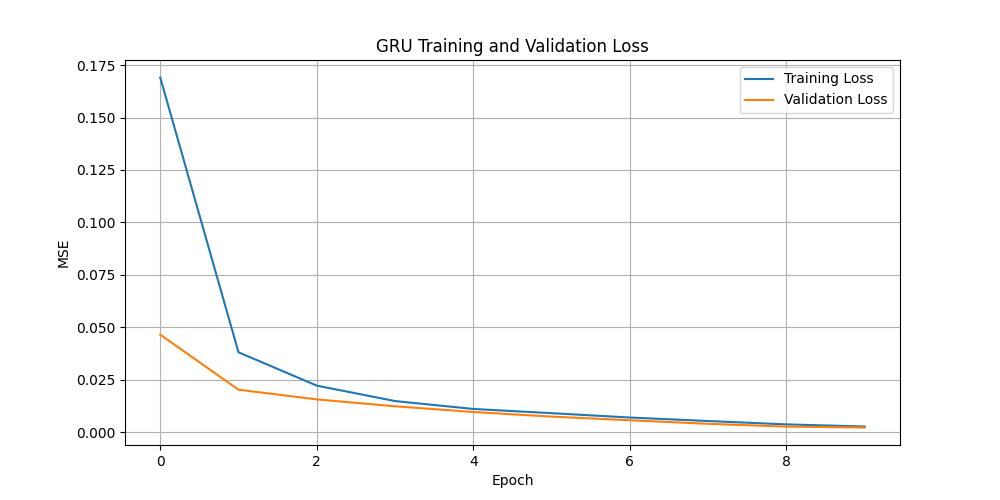

# Lab 17: Exploring GRU Networks

## Project Overview

This project explores Gated Recurrent Unit (GRU) networks for time-series prediction using TensorFlow and Keras.

A synthetic sine-wave dataset with random noise is generated. A GRU model is trained and compared with a Long Short-Term Memory (LSTM) model using the same dataset and training settings.

## Objectives

- Understand GRU architecture and functionality.
- Generate and process time-series data.
- Build and train a GRU model using TensorFlow/Keras.
- Visualize training and validation losses.
- Compare GRU and LSTM performance.
- Record experimental observations and conclusions.

## Technologies Used

- Python 3.12
- TensorFlow CPU 2.17.0
- Keras 3
- NumPy 1.26.4
- Pandas 2.2.3
- Scikit-learn 1.5.2
- SciPy 1.14.1
- Matplotlib 3.9.2
- Ubuntu 24.04 LTS

## Project Structure

```text
Lab-17-Exploring-GRU-Networks/
├── data/
│   └── sample_time_series.csv
├── gru_lab.py
├── gru_loss.png
├── observations.txt
├── requirements.txt
└── README.md
```

## Environment Setup

Create and activate a Python virtual environment:

```bash
python3 -m venv gru-lab-env
source gru-lab-env/bin/activate
```

Install dependencies:

```bash
pip install --upgrade pip
pip install -r requirements.txt
```

## Dataset Generation

The experiment uses 1,000 time-series records containing a sine-wave signal with random noise.

A random seed of 42 ensures reproducibility.

Dataset location: `data/sample_time_series.csv`

## Data Preprocessing

The dataset is divided chronologically:

- First 80%: Training data.
- Last 20%: Testing data.
- Sequence length: 50 time steps.

MinMaxScaler is fitted only on training data and then applied to testing data.

Expected sequence shapes:

| Dataset | Shape |
|---|---|
| Training input | (750, 50, 1) |
| Testing input | (150, 50, 1) |

## GRU Model Architecture

The GRU model contains:

1. Input layer with 50 time steps and one feature.
2. First GRU layer with 50 units and `return_sequences=True`.
3. Second GRU layer with 50 units.
4. Dense output layer with one neuron.

Configuration:

- Optimizer: Adam
- Loss function: Mean Squared Error
- Epochs: 10
- Batch size: 64

Total parameters with the installed Keras 3 defaults: 23,301.

## GRU Training Visualization

The training and validation loss curves are saved as `gru_loss.png`.



## GRU vs LSTM Comparison

Both models use two recurrent layers with 50 units each and the same training settings.

| Metric | GRU | LSTM |
|---|---:|---:|
| Parameters | 23,301 | 30,651 |
| Epochs | 10 | 10 |
| Test loss | 0.00226 | 0.00193 |
| Training time | 14.1 seconds | 12.5 seconds |

These values are from the experiment run in the Ubuntu EC2 CPU environment.

## Observations

- Both models learned the time-series pattern successfully.
- Training and validation losses decreased.
- LSTM achieved a lower test loss in this experiment.
- GRU used fewer trainable parameters.
- LSTM trained faster in this particular run.
- GRU may be useful when a smaller model is preferred.
- LSTM may be useful when its additional memory capability improves sequence learning.

See `observations.txt` for detailed experimental results.

## How to Run

Activate the virtual environment:

```bash
source gru-lab-env/bin/activate
```

Run the experiment:

```bash
python gru_lab.py
```

The script trains both models, evaluates their test losses, and generates the GRU training-loss graph.

## Conclusion

This experiment demonstrates how GRU networks can be used for sequence modeling and time-series prediction.

LSTM achieved a lower test loss, while GRU used fewer trainable parameters in this experiment.

The choice between GRU and LSTM depends on model size, accuracy requirements, dataset characteristics, and computational resources.

## Learning Outcomes

- Time-series dataset generation.
- Data preprocessing and normalization.
- Sequence creation for recurrent neural networks.
- GRU model construction and training.
- LSTM model construction and evaluation.
- Training-loss visualization.
- Experimental comparison and documentation.
