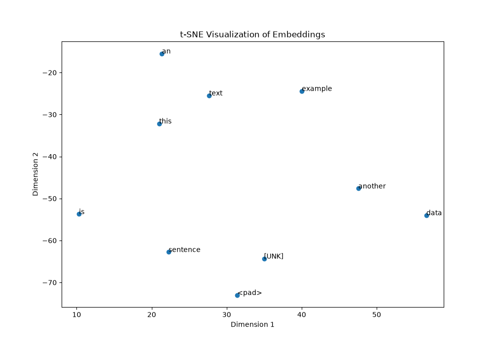

# Lab 19: Building a Simple Embedding Layer

## 1. Introduction

In this lab, I created a simple Embedding Layer using TensorFlow and Keras.

An Embedding Layer converts integer word IDs into numerical vectors. These vectors are trainable and help a neural network process text data.

## 2. Objectives

- Understand the purpose of an Embedding Layer.
- Build a neural network using Keras.
- Convert text into integer sequences.
- Train the model using a small text dataset.
- Extract word embedding vectors.
- Visualize embeddings using t-SNE.

## 3. Technologies Used

| Technology | Version |
|---|---|
| Python | 3.12.3 |
| TensorFlow CPU | 2.17.0 |
| NumPy | 1.26.4 |
| Scikit-learn | 1.9.1 |
| Matplotlib | 3.11.2 |

## 4. Model Architecture

The model contains three main layers:

| Layer | Configuration | Parameters |
|---|---|---:|
| Embedding | 1000 vocabulary entries, 50 dimensions | 50,000 |
| Flatten | Converts embeddings into a single vector | 0 |
| Dense | 1 neuron, sigmoid activation | 501 |

**Total Parameters: 50,501**

## 5. Dataset

I used two example sentences:

1. This is an example sentence
2. Another text data example

Labels:

- First sentence: 0
- Second sentence: 1

## 6. Text Preprocessing

I used TensorFlow's `TextVectorization` layer.

It converts words into integer token IDs.

The maximum sequence length was 10.

Shorter sentences were padded with zeros.

### Vocabulary Output

```text
['', '[UNK]', 'example', 'this', 'text',
 'sentence', 'is', 'data', 'another', 'an']
```

### Integer Sequences

```text
[[3 6 9 2 5 0 0 0 0 0]
 [8 4 7 2 0 0 0 0 0 0]]
```

## 7. Model Training

Training configuration:

- Optimizer: Adam
- Loss Function: Binary Crossentropy
- Metric: Accuracy
- Epochs: 10
- Batch Size: 2

### Training Results

- Final training accuracy: 100%
- Final training loss: 0.6387

### Model Predictions

```text
[0.46913618 0.5317871]
```

These values represent the predicted probabilities for the two example sentences.

## 8. Extracting Embeddings

After training, I extracted the embedding weights from the Embedding layer.

Embedding matrix shape:

```text
(1000, 50)
```

This means the embedding matrix contains 1000 rows, with 50 numerical values per row.

I also extracted the embedding vector for the word `example`.

## 9. Visualizing Embeddings with t-SNE

I used t-SNE from Scikit-learn to reduce the embedding dimensions from 50 to 2.

This makes it possible to display the selected word embeddings in a two-dimensional scatter plot.

Reduced embedding shape:

```text
(10, 2)
```

### Visualization Output



## 10. Project Files

```text
Lab-19-Building-a-Simple-Embedding-Layer/
│
├── embed.py
├── requirements.txt
├── README.md
└── tsne_embeddings.png
```

## 11. How to Run the Project

### Step 1: Create a virtual environment

```bash
python3 -m venv venv
```

### Step 2: Activate the environment

```bash
source venv/bin/activate
```

### Step 3: Install dependencies

```bash
pip install -r requirements.txt
```

### Step 4: Run the Python program

```bash
python embed.py
```

The program displays the model summary, vocabulary, training results, predictions, and embedding information. It also generates the t-SNE visualization.

## 12. Observations and Limitations

- The Embedding layer converts token IDs into trainable numerical vectors.
- The model successfully trained for 10 epochs.
- The embedding matrix has 1000 rows and 50 dimensions.
- t-SNE reduced the selected embeddings to two dimensions.
- The dataset contains only two sentences, so this is a basic demonstration.
- The 100% training accuracy does not demonstrate performance on unseen text.
- Most vocabulary entries are not used in this small dataset.

## 13. Conclusion

In this lab, I successfully built and trained a simple Embedding Layer using TensorFlow and Keras.

I learned how to convert text into integer sequences, train a neural network, extract embedding vectors, and visualize them using t-SNE.
