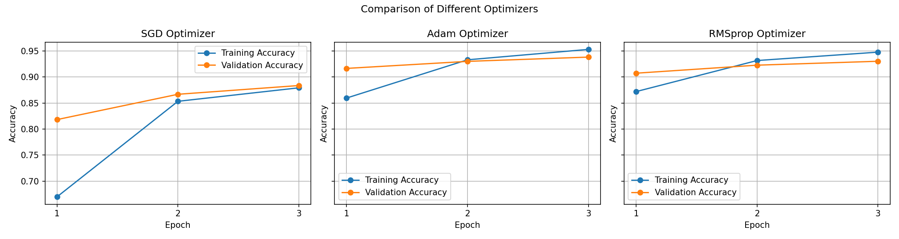

# Lab 23: Experimenting with Different Optimizers

---

## 1. Objective

- Understand the role of optimizers in neural network training.
- Implement different optimizers using TensorFlow and Keras.
- Compare training loss and accuracy.
- Analyze the performance of SGD, Adam, and RMSprop.

## 2. Environment Setup

- Operating System: Ubuntu 24.04
- Python Version: 3.12.3
- TensorFlow: 2.17.0
- Keras: 3.15.1
- Matplotlib: 3.9.2
- Dataset: MNIST

### Installation Commands

**Step 1: Create Virtual Environment**

```bash
python3 -m venv venv
```

**Step 2: Activate Virtual Environment**

```bash
source venv/bin/activate
```

**Step 3: Install Required Packages**

```bash
pip install tensorflow-cpu==2.17.0 matplotlib==3.9.2
```

**Step 4: Verify Installed Packages**

```bash
python3 -c "import tensorflow as tf, keras, matplotlib; print(tf.__version__, keras.__version__, matplotlib.__version__)"
```

## 3. Dataset

**MNIST (Modified National Institute of Standards and Technology)**

- Contains handwritten digit images.
- Images are grayscale.
- Image size: 28 × 28 pixels.
- Contains 10 classes (digits 0–9).
- Used 10,000 training samples and the complete test dataset.

## 4. Model Architecture

The neural network contains:

1. Input Layer: Accepts 28 × 28 images.
2. Flatten Layer: Converts images into a one-dimensional array.
3. Dense Layer: 128 neurons with ReLU activation.
4. Output Layer: 10 neurons with Softmax activation.

## 5. Training Configuration

- Epochs: 3
- Batch Size: 32
- Loss Function: Categorical Crossentropy
- Evaluation Metric: Accuracy
- Random Seed: 42

## 6. Optimizers Used

### A. SGD (Stochastic Gradient Descent)

- Updates model weights using gradients.
- Simple and widely used optimization algorithm.
- Achieved 88.36% test accuracy.

### B. Adam (Adaptive Moment Estimation)

- Uses adaptive learning rates.
- Combines momentum and adaptive gradient information.
- Achieved 93.82% test accuracy.

### C. RMSprop (Root Mean Square Propagation)

- Adjusts learning rates using moving averages of squared gradients.
- Helps improve optimization during training.
- Achieved 93.02% test accuracy.

## 7. Commands Used

**Run SGD:**

```bash
python3 lab.py sgd
```

**Run Adam:**

```bash
python3 lab.py adam
```

**Run RMSprop:**

```bash
python3 lab.py rmsprop
```

**Generate Comparison Graph:**

```bash
python3 plot.py
```

## 8. Experimental Results

| Optimizer | Test Loss | Test Accuracy |
|---|---:|---:|
| SGD | 0.4567 | 88.36% |
| Adam | 0.2067 | 93.82% |
| RMSprop | 0.2333 | 93.02% |

## 9. Result Analysis

- SGD achieved 88.36% accuracy.
- Adam achieved the highest accuracy of 93.82%.
- RMSprop achieved 93.02% accuracy.
- Adam produced the lowest test loss of 0.2067.
- Adam performed better than SGD and RMSprop in this experiment.

## 10. Graphical Comparison

The graph compares training accuracy and validation accuracy for all three optimizers over three epochs.



## 11. Conclusion

This experiment demonstrated that different optimizers affect neural network training performance.

Adam achieved the best results with 93.82% test accuracy and 0.2067 test loss. RMSprop also performed well, while SGD achieved comparatively lower accuracy.

Therefore, Adam was the best-performing optimizer in this experiment.

## 12. Project Files

- `lab.py` — Main training and evaluation program.
- `plot.py` — Generates the optimizer comparison graph.
- `results/sgd.json` — SGD training results.
- `results/adam.json` — Adam training results.
- `results/rmsprop.json` — RMSprop training results.
- `optimizers.png` — Comparison graph.
- `README.md` — Lab documentation.

---

**Lab 23 Status: Completed**
