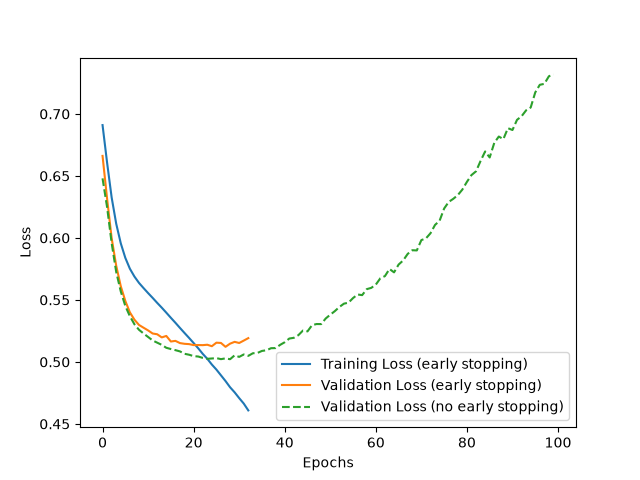

# Lab 28: Implementing Early Stopping

## 1. Introduction

Early Stopping is a technique used in Deep Learning to stop model training when the model stops improving.

It helps prevent overfitting and saves training time.

In this lab, we use TensorFlow and Keras to implement Early Stopping and compare two models.

## 2. Objectives

- Understand Early Stopping.
- Learn how to use the Keras EarlyStopping callback.
- Train a neural network with Early Stopping.
- Compare training with and without Early Stopping.
- Evaluate model performance.
- Create a training history graph.

## 3. Tools and Technologies

- Python 3.12.3
- TensorFlow 2.17.0
- Keras 3.15.1
- NumPy 1.26.4
- Matplotlib 3.11.2
- Ubuntu 24.04.3 LTS

## 4. Dataset Preparation

We created a synthetic dataset using NumPy.

Dataset details:

- Training samples: 1000
- Validation samples: 200
- Features: 20
- Target: Binary classification (0 or 1)

The target is generated using the sum of the first five features with random noise.

## 5. Neural Network Model

We created a Sequential neural network model.

Model architecture:

1. Input layer: 20 features
2. Hidden layer 1: 64 neurons with ReLU activation
3. Hidden layer 2: 32 neurons with ReLU activation
4. Output layer: 1 neuron with Sigmoid activation

Model configuration:

- Optimizer: Adam
- Loss function: Binary Crossentropy
- Evaluation metric: Accuracy
- Maximum epochs: 100
- Batch size: 32

## 6. What is Early Stopping?

Early Stopping is a Keras callback that monitors model performance during training.

When validation loss stops improving for a specified number of epochs, training automatically stops.

We used the following configuration:

```python
EarlyStopping(
    monitor='val_loss',
    patience=5,
    restore_best_weights=True
)
```

Explanation:

- monitor: Monitors validation loss.
- patience: Waits for 5 epochs without improvement.
- restore_best_weights: Restores the best model weights.

## 7. Model Training

We trained two models.

### Model 1: With Early Stopping

- Maximum epochs: 100
- Early Stopping callback enabled.
- Training stopped automatically when validation loss stopped improving.

### Model 2: Without Early Stopping

- Maximum epochs: 100
- No Early Stopping callback.
- Model completed all 100 epochs.

## 8. Model Evaluation

We evaluated both models using validation data.

Actual results:

| Measurement | With Early Stopping | Without Early Stopping |
|---|---:|---:|
| Epochs | 33 | 100 |
| Validation Loss | 0.5122 | 0.7319 |
| Validation Accuracy | 75% | 66% |

## 9. Results and Observations

1. The Early Stopping model completed training in 33 epochs.
2. The baseline model completed all 100 epochs.
3. The Early Stopping model achieved lower validation loss.
4. The Early Stopping model achieved higher validation accuracy.
5. Early Stopping reduced unnecessary training.

### Important Observation

Early Stopping saved 67 training epochs in this experiment.

It also achieved better validation performance than the baseline model.

## 10. Training History Graph

The training history graph compares:

- Training loss with Early Stopping.
- Validation loss with Early Stopping.
- Validation loss without Early Stopping.

The graph is saved as:

`history.png`



## 11. Commands Used

Create virtual environment:

```bash
python3 -m venv ~/lab-venv
```

Activate virtual environment:

```bash
source ~/lab-venv/bin/activate
```

Install dependencies:

```bash
pip install -r requirements.txt
```

Run Python script:

```bash
python es_lab.py
```

Check generated graph:

```bash
ls -lh history.png
```

## 12. Conclusion

In this lab, we learned how to implement Early Stopping using TensorFlow and Keras.

We compared a model trained with Early Stopping against a baseline model trained for 100 epochs.

The Early Stopping model achieved 75% validation accuracy in 33 epochs, while the baseline achieved 66% validation accuracy in 100 epochs.

This experiment demonstrated how Early Stopping can reduce training time and improve validation performance.

## 13. Files Included

- `es_lab.py` – Python implementation of Early Stopping.
- `history.png` – Training history graph.
- `requirements.txt` – Required Python packages.
- `README.md` – Lab documentation and notes.
