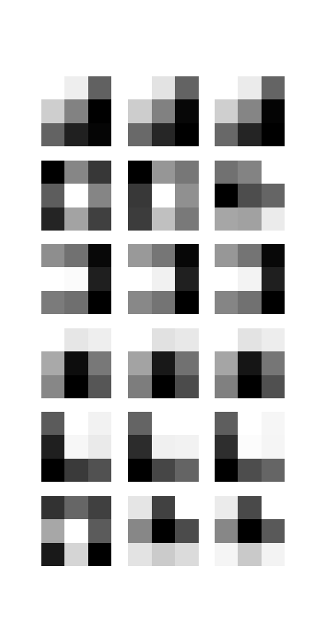

# Lab 30: Visualizing Convolutional Filters

## 1. Introduction

In this lab, I learned how to extract and visualize convolutional filters from a pretrained Convolutional Neural Network (CNN) using the VGG16 model.

Convolutional filters help CNNs detect visual features such as edges, colors, textures, and patterns in images.

## 2. Objectives

- Understand convolutional filters in CNNs.
- Load a pretrained VGG16 model.
- Extract filters and biases from a convolutional layer.
- Normalize filter weights.
- Visualize filters using Matplotlib.
- Understand positive and negative filter weights.
- Learn how CNNs extract visual features.

## 3. Environment and Requirements

- OS: Ubuntu 24.04 LTS
- Python: 3.12.3
- TensorFlow CPU: 2.17.0
- Matplotlib: 3.9.2
- NumPy: 1.26.4
- Pretrained Model: VGG16

## 4. Project Structure

```text
Lab-30-Visualizing-Convolutional-Filters/
├── filters.py
├── filters.png
├── requirements.txt
└── README.md
```

## 5. Task 1: Extract Convolutional Filters

Loaded the pretrained VGG16 model using TensorFlow Keras.

Selected the first convolutional layer:

```python
layer_name = 'block1_conv1'
layer_model = model.get_layer(name=layer_name)

filters, biases = layer_model.get_weights()

print('filters.shape', filters.shape)
```

### Output

```text
filters.shape (3, 3, 3, 64)
```

### Explanation

- 3: Filter height.
- 3: Filter width.
- 3: RGB input channels.
- 64: Total number of filters.

## 6. Task 2: Normalize and Visualize Filters

Normalized the filter weights between 0 and 1.

Selected six filters and displayed their three RGB channels separately using Matplotlib.

Saved the visualization as:

```text
filters.png
```

### Visualization



### Verification

```text
SUCCESS: filters.png exists and is not empty
PNG image: 400 x 800
```

## 7. Task 3: Inspect Raw Filter Weights

Extracted the original pretrained weights from the first convolutional layer.

### First Filter, First Channel

```text
[[ 0.43  0.37 -0.06]
 [ 0.27  0.04 -0.37]
 [-0.06 -0.26 -0.35]]
```

### Weight Range

```text
Minimum weight: -0.67140007
Maximum weight: 0.6085159
```

### Explanation

- Positive weights contribute positively to the convolution response.
- Negative weights contribute negatively.
- Different weight patterns help detect edges and intensity changes.

These are raw pretrained weights, not normalized values.

## 8. CNN Feature Extraction

CNN layers learn different visual features.

| Layer | Features |
|---|---|
| Early layers | Edges and colors |
| Intermediate layers | Textures and shapes |
| Deeper layers | Complex visual features |

## 9. Key Learnings

1. Loaded a pretrained VGG16 model.
2. Extracted convolutional filters and biases.
3. Understood filter dimensions.
4. Normalized filter weights.
5. Visualized six convolutional filters.
6. Inspected raw pretrained weights.
7. Understood basic CNN feature extraction.

## 10. Conclusion

In this lab, I learned how to extract, normalize, and visualize convolutional filters using a pretrained VGG16 model.

I also understood how CNNs use learned filters to identify basic visual patterns and extract useful features from images.
