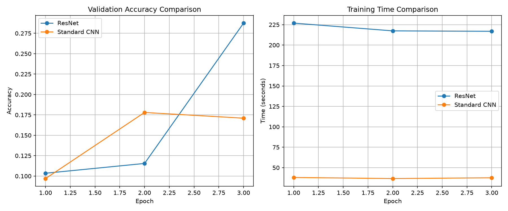

# Lab 32: Building a Residual Block (ResNet) – Basic Version

---

## 1. Introduction

In this lab, I implemented a basic Residual Network (ResNet) using Python and TensorFlow/Keras.

A Residual Network is a type of Convolutional Neural Network (CNN) that uses shortcut connections to help information and gradients flow through the network.

I also created a standard CNN without residual connections to compare both models.

---

## 2. Objectives

- Understand the concept of residual learning.
- Build a basic residual block using TensorFlow/Keras.
- Understand main paths and shortcut connections.
- Create a simple ResNet model.
- Create a standard CNN model.
- Train both models using the CIFAR-10 dataset.
- Compare validation accuracy and training time.

---

## 3. Prerequisites

- Basic Python programming.
- Understanding of neural networks.
- Basic knowledge of CNNs.
- Familiarity with TensorFlow and Keras.
- Ubuntu Linux environment.

---

## 4. Environment Setup

Operating System: Ubuntu 24.04 LTS

Python Version: 3.12.3

TensorFlow CPU: 2.17.0

Matplotlib: 3.11.2

NumPy: 1.26.4

### Create a Virtual Environment

```bash
python3 -m venv venv
```

### Activate the Environment

```bash
source venv/bin/activate
```

### Install Dependencies

```bash
python -m pip install -r requirements.txt
```

### Verify Installed Packages

```bash
python -c "import tensorflow as tf, numpy, matplotlib; print('TensorFlow:', tf.__version__); print('NumPy:', numpy.__version__); print('Matplotlib:', matplotlib.__version__)"
```

---

## 5. Project Structure

```text
Lab-32-Building-a-Residual-Block-ResNet/
│
├── blocks.py
├── models.py
├── train.py
├── requirements.txt
├── README.md
│
├── resnet.keras
├── plain_cnn.keras
├── comparison.png
│
└── venv/
```

Note: The virtual environment is used locally and should not be uploaded to GitHub.

---

## 6. Understanding Residual Learning

Residual learning is a technique used in ResNet architectures.

A normal neural network learns a direct mapping from input to output.

A residual block learns a residual mapping and adds the original input through a shortcut connection.

The basic equation is:

```text
Output = ReLU(Main Path + Shortcut Path)
```

### Main Path

The main path contains:

1. First 3x3 Convolution.
2. Batch Normalization.
3. ReLU activation.
4. Second 3x3 Convolution.
5. Batch Normalization.

### Shortcut Path

The shortcut path carries the original input.

If the input and output dimensions do not match, a 1x1 convolution and Batch Normalization are used to match their dimensions.

### Why Residual Connections?

- Help information flow through deeper networks.
- Improve gradient flow during training.
- Help reduce the vanishing gradient problem.
- Make deeper neural networks easier to train.

---

## 7. File 1: blocks.py

This file contains the `residual_block()` function.

The function:

- Accepts an input feature map.
- Applies two 3x3 convolutions in the main path.
- Uses Batch Normalization.
- Applies ReLU activation.
- Creates a shortcut connection.
- Uses a 1x1 convolution when dimensions need matching.
- Adds both paths.
- Applies the final ReLU activation.

---

## 8. File 2: models.py

This file contains two model-building functions.

### A. create_resnet()

The ResNet model contains:

1. Initial 3x3 convolution with 64 filters.
2. Batch Normalization.
3. ReLU activation.
4. First residual block.
5. Second residual block.
6. Global Average Pooling.
7. Dense output layer with 10 classes.

### B. create_standard_cnn()

The standard CNN contains:

1. First convolution with 32 filters.
2. Batch Normalization and ReLU.
3. Second convolution with 64 filters.
4. Batch Normalization and ReLU.
5. Max Pooling.
6. Global Average Pooling.
7. Dense output layer with 10 classes.

The standard CNN does not use residual connections.

---

## 9. File 3: train.py

This file performs model training and comparison.

### Dataset

The CIFAR-10 dataset was used.

It contains 10 image classes.

Each image has dimensions of 32x32 pixels with 3 color channels (RGB).

### Dataset Selection

- Training images: 10,000
- Testing images: 2,000

### Data Preprocessing

Images were converted to float32 and normalized by dividing pixel values by 255.

This scales pixel values from 0–255 to 0–1.

### Training Configuration

| Setting | Value |
|---|---|
| Optimizer | Adam |
| Loss Function | Sparse Categorical Crossentropy |
| Metric | Accuracy |
| Epochs | 3 |
| Batch Size | 64 |
| Training Samples | 10,000 |
| Testing Samples | 2,000 |

### Model Saving

The trained models are saved as:

- `resnet.keras`
- `plain_cnn.keras`

A comparison graph is generated as:

- `comparison.png`

---

## 10. How to Run the Project

Activate the virtual environment:

```bash
source venv/bin/activate
```

Install dependencies:

```bash
python -m pip install -r requirements.txt
```

Run the training script:

```bash
python train.py
```

The script downloads CIFAR-10 if it is not already available, trains both models, saves the models, and generates the comparison graph.

---

## 11. Training Results

The following results were obtained during the experiment.

### Final Training and Validation Accuracy

| Metric | ResNet | Standard CNN |
|---|---:|---:|
| Final Training Accuracy | 50.54% | 41.83% |
| Final Validation Accuracy | 28.75% | 17.10% |

### Training Time

| Epoch | ResNet | Standard CNN |
|---|---:|---:|
| Epoch 1 | 227 seconds | 38 seconds |
| Epoch 2 | 217 seconds | 37 seconds |
| Epoch 3 | 217 seconds | 38 seconds |

### Result Analysis

- ResNet achieved 28.75% validation accuracy.
- Standard CNN achieved 17.10% validation accuracy.
- ResNet performed better in validation accuracy in this experiment.
- ResNet required more training time than the standard CNN.
- Both models completed all three training epochs successfully.

The results are based on a limited dataset and only three epochs. More training and experimentation would be required to improve model performance.

---

## 12. Comparison Graph

The graph below compares the validation accuracy and training time of both models.



---

## 13. Model Verification

Both saved models were loaded successfully using TensorFlow/Keras.

Verification:

```python
import tensorflow as tf

for path in ("resnet.keras", "plain_cnn.keras"):
    model = tf.keras.models.load_model(path)
    print(path, "loaded successfully")
    print("Output shape:", model.output_shape)
```

### Verification Output

```text
resnet.keras loaded successfully
Output shape: (None, 10)

plain_cnn.keras loaded successfully
Output shape: (None, 10)
```

Both models produce 10 output values for the 10 CIFAR-10 classes.

---

## 14. Key Learnings

Through this lab, I learned:

- How residual learning works.
- How shortcut connections are implemented.
- How to use 1x1 convolutions to match dimensions.
- How to build CNN models using the Keras Functional API.
- How to load and preprocess CIFAR-10.
- How to train and save deep learning models.
- How to compare model accuracy and training time.
- How to load saved Keras models for verification.

---

## 15. Conclusion

In this lab, I successfully implemented a basic ResNet architecture and a standard CNN using TensorFlow/Keras.

Both models were trained on the CIFAR-10 dataset for three epochs.

ResNet achieved higher validation accuracy than the standard CNN in this experiment, although it required more training time.

This experiment helped me understand the importance of residual connections in deep learning architectures.

---

## 16. Lab Status

**Status: Completed**

- [x] Environment setup
- [x] Dependencies installed
- [x] Residual block implemented
- [x] ResNet model created
- [x] Standard CNN model created
- [x] CIFAR-10 dataset loaded
- [x] Both models trained
- [x] Models saved
- [x] Comparison graph generated
- [x] Saved models loaded and verified
- [x] README documentation created
